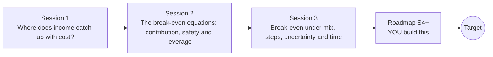

# openbreakeven

[](https://github.com/KrunalPanchal1995/openbreakeven/actions/workflows/ci.yml)   [](https://colab.research.google.com/github/KrunalPanchal1995/openbreakeven/blob/main/sessions/session-01/lesson.ipynb) [](https://krunalpanchal1995.github.io/openbreakeven/)

**Find the break-even point of a small business, in three sessions.**

openbreakeven teaches how a small business finds the sales it needs to cover its costs, from a lemonade stall to risk, sensitivity and payback, using only Python and a browser.

- **Start from a lemonade stall.** Session 1 needs only school arithmetic: a cost line, an income line, and where they meet.
- **See it move.** Every session ships a slider app that runs in the browser, with labelled graphs.
- **Know you got it right.** Each session ends with a checkpoint that prints PASS or FAIL against hand calculations and numerical scans.
- **Build the missing half.** The repo stops at Session 3 on purpose; the roadmap shows the path to the Target.

[Target](#the-target) · [Who is this for](#who-is-this-for) · [Quick start](#quick-start) · [Sessions](#sessions) · [Roadmap](#roadmap) · [Contribute](#contribute) · [Explainer PDF](docs/explainer.pdf)

> **This repo is incomplete on purpose.** Sessions 1 to 3 are here and fully working. The finished Target below is a preview of what the community can build next. We show you the path, not the code. Sessions 4 and up are yours.

## The Target

One bakery, three linked pictures that move together as the price and the fixed cost change. The cost and income lines cross at a break-even point that slides along them. Beside them a histogram of thousands of simulated months turns red where the bakery loses money, and its title shows the chance of a loss. Below, a tornado chart ranks which input moves profit most. Your goal over the coming sessions: build all three yourself and make them respond to sliders in the browser.


*Target: break-even lines, Monte Carlo profit histogram and tornado chart moving together*


*Target, one frame: a higher price and a higher fixed cost*


*Target, another frame: a low price shifts the break-even and the loss chance*


*Target, a third frame: a high price with demand falling*

Try it live:

- [Math Visual Studio (explore functions and lines)](https://krunalpanchal1995.github.io/studio/)

How the Target was made is shown only as a path in [promo/roadmap.md](promo/roadmap.md).

## Who is this for
**secondary school to diploma / undergraduate (levels 3-5).** Topic area: Economics, Business, Finance and Entrepreneurship.

Prerequisites:

- School arithmetic and the idea of a straight-line graph (y = m x + c).
- Python 3.10 or newer; if `python --version` works, you are ready. PRIMER.md explains the rest.
- No prior GitHub, economics or statistics experience is needed.

New to Python? Read [PRIMER.md](PRIMER.md) first (10 minutes).

## Quick start

No installation knowledge needed. You need [Git](https://git-scm.com/downloads) and [Python 3.10+](https://www.python.org/downloads/) (Windows: tick "Add Python to PATH"). On Mac and Linux type `python3` wherever this page says `python`.

```bash
git clone https://github.com/KrunalPanchal1995/openbreakeven.git
cd openbreakeven
python start.py 1
```

`start.py` creates a private environment, installs what is needed and runs Session 1 with its checkpoint. Next: `python start.py 2`, `python start.py 3`, or `python start.py test` to check everything. Only a checkpoint: `python start.py check 1`.

Four lines turn the idea of Session 1 into a result (they work as they are): Save it as `try.py` and run it with `python start.py run try.py` (this uses the private environment, where NumPy is installed):

```python
import numpy as np
fixed, price, cost = 60.0, 2.00, 0.50          # a made-up lemonade stall
cups = np.arange(0, 101)
profit = price * cups - (fixed + cost * cups)
print("break-even cups:", cups[np.argmax(profit >= 0)])   # -> 40
```

Every session also opens in your browser with sliders (no install): [live apps](https://krunalpanchal1995.github.io/openbreakeven/). Or use the Colab badge above for the notebook.

## Sessions

| # | Session | Model level | Time | Live app |
|---|---|---|---|---|
| 1 | [Where does income catch up with cost?](sessions/session-01/README.md) | Level 1: conceptual interactive model | 60 min | [open](https://krunalpanchal1995.github.io/openbreakeven/session-01/) |
| 2 | [The break-even equations: contribution, safety and leverage](sessions/session-02/README.md) | Level 2: mathematical engineering model | 75 min | [open](https://krunalpanchal1995.github.io/openbreakeven/session-02/) |
| 3 | [Break-even under mix, steps, uncertainty and time](sessions/session-03/README.md) | Level 3: simulation and validation | 90 min | [open](https://krunalpanchal1995.github.io/openbreakeven/session-03/) |

Each session follows the same six steps: A real-world problem, B concept and theory, C visual explanation, D interactive simulation, E worked example and experiment, F assessment and design challenge. Each ends with `checkpoint.py`, which prints `PASS` or `FAIL` against reference numbers. Session 3 also contains the real-world mini-project: **Choose the price and the oven size for a made-up bakery**.

## Architecture



| Folder or file | What is inside |
|---|---|
| `sessions/` | three sessions: README (A-F), `lesson.py`, notebook, live app, exercises, activity sheet, checkpoint |
| `promo/` | the Target: media, live links, and the roadmap (path only) |
| `docs/` | `explainer.tex` and the built `explainer.pdf` |
| `tests/` | runs every lesson and checkpoint headless |
| `start.py` | one command to set up and run anything |
| `QUALITY.md`, `RUBRIC.md` | the quality checklist and the scoring rubric |
| `.github/` | CI, PDF build, Pages deploy, issue and PR templates |

## Roadmap

| Milestone | What you will build | Difficulty |
|---|---|---|
| Session 4: Price and demand move together | A second simulation in which price and demand are negatively correlated (a higher price goes with lower demand). | intermediate |
| Session 5: Shares of the variance | A function that reports, for price, variable cost and demand, the share of profit variance it explains. | advanced |
| Session 6: Seasons and a loan | A 12 month demand pattern with a December peak and a loan repaid in equal monthly instalments. | intermediate |
| Session 7: Design under a risk limit | A search that adds new oven options and prices, and reports the cheapest design that meets the limit. | advanced |
| Session 8: A browser lab with live Monte Carlo | One page with sliders for price, costs, fixed cost and demand, linked to the lines, histogram and tornado chart. | advanced |

Full detail with a checkpoint per milestone: [promo/roadmap.md](promo/roadmap.md).

## Contribute
New to GitHub? Read [CONTRIBUTING.md](CONTRIBUTING.md); it starts from zero. Pick an issue labelled `good first issue`. Translations into Hindi, Telugu, Tamil and Malayalam are welcome.

<details>
<summary>Development</summary>

```bash
python start.py test        # runs every lesson and checkpoint
```
Lessons use `# %%` cell markers so they open as notebooks in VS Code. See [QUALITY.md](QUALITY.md) for the standard every session meets.
</details>

## License
MIT. See [LICENSE](LICENSE). Media in `promo/media` is (c) Krunal Panchal, CC BY 4.0.

## Acknowledgments
Part of the [PAN IIT OSS](https://hellofoss.tech-iitb.org/projects) open-source teaching collection, modelled on the structure of [openspline](https://github.com/openspline/openspline). Built on ideas from the Math Visual Studio at https://krunalpanchal1995.github.io/studio/.
