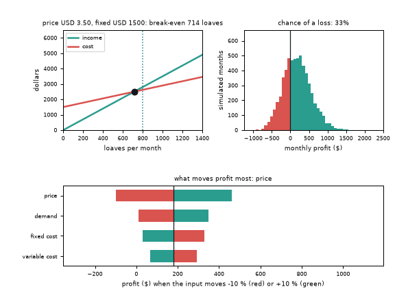
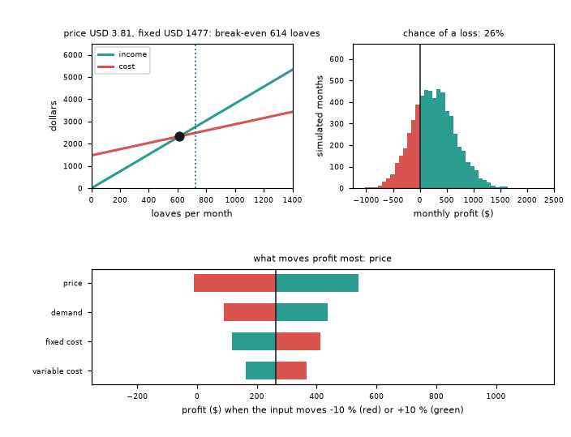
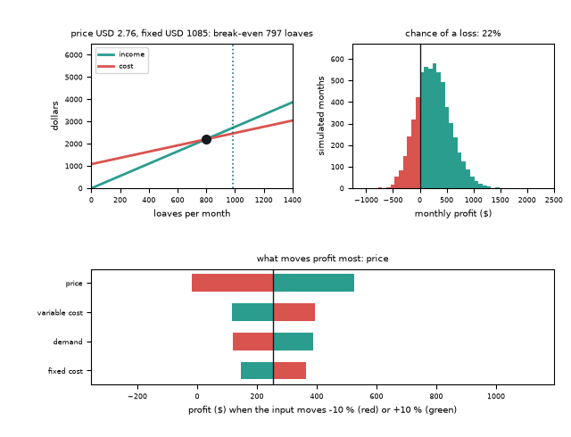
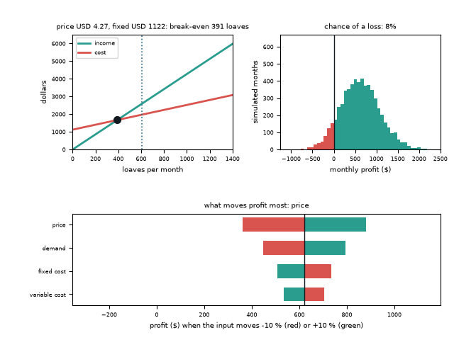

# What you are building toward

One bakery, three linked pictures that move together as the price and the fixed cost change. The cost and income lines cross at a break-even point that slides along them. Beside them a histogram of thousands of simulated months turns red where the bakery loses money, and its title shows the chance of a loss. Below, a tornado chart ranks which input moves profit most. Your goal over the coming sessions: build all three yourself and make them respond to sliders in the browser.

*Target: break-even lines, Monte Carlo profit histogram and tornado chart moving together*

*Target, one frame: a higher price and a higher fixed cost*

*Target, another frame: a low price shifts the break-even and the loss chance*

*Target, a third frame: a high price with demand falling*

These results come from a private reference build. The code is not published; the roadmap shows the path so you can build your own.

Live links:

- [Math Visual Studio (explore functions and lines)](https://krunalpanchal1995.github.io/studio/)
