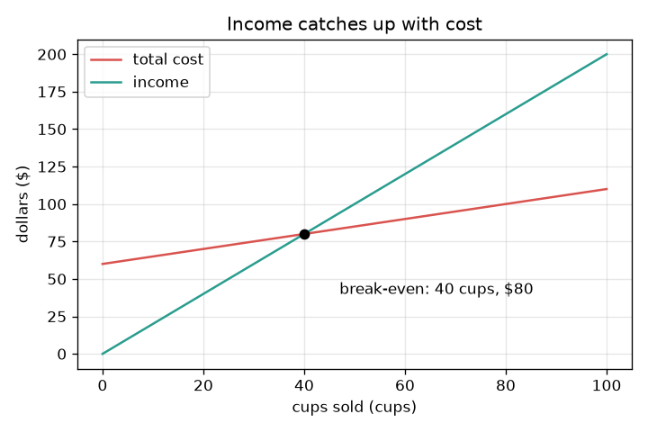
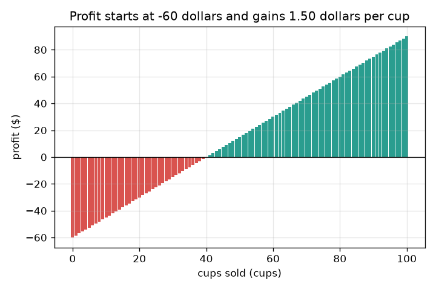

# Session 1: Where does income catch up with cost?

*Level 1 (conceptual interactive model) · about 60 minutes · openbreakeven*

> This is a simplified educational model. It is not a validated design tool and must not be used for real structures, electrical installations, vehicles, industrial processes or medical decisions.

**Prerequisites**

- School arithmetic: multiplication and division.
- You have read PRIMER.md and run `python start.py 1` once.

**Learning objectives.** After this session you can:

- Separate fixed cost (paid once) from the cost of each cup.
- Write the cost line and the income line, and find where they meet.
- Compute the break-even number of cups with one division.
- Read a graph of cost and income against cups sold, and say when there is no break-even.

## A. Real-world problem
You want to run a lemonade stall. Before you sell a single cup you must pay 60 dollars for the stall, a pitcher and a sign. After that each cup costs 50 cents to make and sells for 2 dollars. At the start you are 60 dollars behind. How many cups until your total income has caught up with your total cost? That number is the break-even point. (General education only: the stall is made up and this is not financial advice.)

## B. Concept and theory
The fixed cost F is paid once, however many cups you sell. The variable cost v is paid for every cup. So the total cost after q cups is F + v q, a straight line that starts at F. The income is the price p times q, a straight line that starts at 0. Profit is income minus cost. Each cup earns p - v dollars towards paying off F, so the cups needed are F divided by what one cup earns. If p is not larger than v, a cup earns nothing and income never catches up: there is no break-even.

| Symbol | Meaning | Unit |
|---|---|---|
| F | fixed cost, paid once | dollars |
| v | variable cost of one cup | dollars per cup |
| p | price of one cup | dollars per cup |
| q | cups sold | cups |
| q* | break-even number of cups | cups |

**Assumptions**

- Every cup made is sold, and always at the same price.
- The cost of one cup stays the same however many you make.
- Money today is worth the same as money later (Session 3 relaxes this).
- The stall and its numbers are made up.

$$ \text{cost}(q)=F+v\,q,\qquad \text{income}(q)=p\,q $$

$$ \text{profit}(q)=p\,q-(F+v\,q)=(p-v)\,q-F $$

$$ q^{*}=\frac{F}{p-v}\quad(\text{only if } p>v) $$

## C. Visual explanation
The first figure draws both lines against cups sold. The red cost line starts at 60 dollars and rises slowly, 50 cents per cup. The green income line starts at 0 and rises faster, 2 dollars per cup. They cross at 40 cups and 80 dollars: that is the break-even point. The second figure shows the profit after each cup as a bar. It starts at minus 60 dollars, each cup adds 1.50 dollars, and the bars turn green at 40 cups.

*Cost and income against cups sold: they cross at 40 cups and 80 dollars.*

*Profit after each cup: it starts at minus 60 dollars and gains 1.50 dollars per cup.*

## D. Interactive simulation
Run the lesson (`python start.py 1`), then open the live app: [Session 1: the lemonade stall](https://krunalpanchal1995.github.io/openbreakeven/session-01/) (or `app.html` in this folder). Move the cups slider and watch the two bars: money out and money in. Then open the graph view and change the price, the cost of a cup and the fixed cost one at a time.

**Challenge.** Make the stall break even within 30 cups.

## E. Worked example and experiment
**Problem.** A stall has fixed cost 60 dollars, sells cups at 2.00 dollars and spends 0.50 dollars per cup. Find the break-even number of cups and check it.

1. Each cup earns 2.00 - 0.50 = 1.50 dollars towards the fixed cost.
2. Cups needed = 60 / 1.50 = 40 cups.
3. Check cost: 60 + 0.50 * 40 = 80 dollars. Check income: 2.00 * 40 = 80 dollars. They are equal.
4. One cup earlier, at 39 cups, the profit is minus 1.50 dollars; one cup later, at 41 cups, it is plus 1.50 dollars.

**Answer.** Break-even is at 40 cups, where income and cost are both 80 dollars.

**Experiment.** Run a real or pretend stall at school: write down what you spent first, then keep a tally of cups sold and the money taken. Plot the running totals and see where they cross. Expect the crossing to differ from 40 cups: some cups are spilt, the price may change, and the cost of a cup is only an average. The model uses one fixed price and cost and assumes every cup made is sold.

## F. Assessment and design challenge
**Question type A: Conceptual.** A friend says: the stall costs 60 dollars and each cup sells for 2 dollars, so break-even is 60 / 2 = 30 cups. What did they forget?

Hint

Does a cup cost anything to make?

Step-by-step solution

They forgot the variable cost. Each cup brings in 2.00 dollars but also costs 0.50 dollars to make, so it only helps the fixed cost by 1.50 dollars. The right answer is 60 / 1.50 = 40 cups, not 30.

**Question type B: Numerical.** A different stall has fixed cost 45 dollars, price 1.50 dollars and a cup cost of 0.60 dollars. Find the break-even cups and check that income equals cost there.

Hint

Earn per cup = price minus cup cost; then divide.

Step-by-step solution

Each cup earns 1.50 - 0.60 = 0.90 dollars. Cups = 45 / 0.90 = 50. Check: income = 1.50 * 50 = 75 dollars; cost = 45 + 0.60 * 50 = 75 dollars. Equal. Units: dollars divided by dollars per cup gives cups.

**Question type C: Graph and simulation interpretation.** On the graph of the first stall, read the cost, the income and the profit at 25 cups. Is the stall ahead or behind?

Hint

Cost line value is 60 plus 0.50 times 25; income is 2.00 times 25.

Step-by-step solution

At 25 cups the cost is 60 + 12.50 = 72.50 dollars and the income is 50 dollars. The profit is 50 - 72.50 = minus 22.50 dollars, a loss: the red line is still above the green line, so the stall is behind.

**Question type D: Design and optimisation challenge.** Design: the stall will only be open for a short day. Change either the price or the fixed cost so that break-even is at 30 cups or fewer. Which would you pick and what is the risk?

Hint

Try price 2.50 with the same fixed cost, and fixed cost 45 with the same price. Then try price 1.00 to see the other direction.

Step-by-step solution

Price 2.50 dollars: each cup earns 2.00, so 60 / 2.00 = 30 cups. Or fixed cost 45 dollars at price 2.00: 45 / 1.50 = 30 cups. Both work. A higher price risks fewer customers (this simple model ignores that); a smaller fixed cost means a cheaper stall, which may be smaller or worse placed. A price of 1.00 dollar would need 60 / 0.50 = 120 cups, so cutting the price a lot pushes break-even far away.

Score yourself with [RUBRIC.md](../../RUBRIC.md). Print the [activity sheet](activity_sheet.md) to work on paper.

## Common misconceptions
| Common misconception | What is actually true |
|---|---|
| Break-even is the number of cups that pay for the stall. | Each cup also costs something to make; only what is left, price minus cup cost, pays for the stall. |
| At break-even the stall has made a profit. | At break-even the profit is exactly zero. Profit starts with the next cup. |
| A higher price always brings break-even sooner. | In this model yes, but real customers buy fewer cups at a higher price; Session 2 adds that. |
| If I sell enough cups I will always break even. | Only if the price is above the cost of a cup. Otherwise every extra cup makes the loss bigger. |

## Glossary
- **fixed cost**: money paid once, whatever the number of cups sold
- **variable cost**: money spent on each cup made
- **income (revenue)**: price times cups sold
- **profit**: income minus total cost; negative means a loss
- **break-even**: the number of cups where income equals cost, so profit is zero

## Finish
1. Do the three coding tasks in [exercises.md](exercises.md).
2. Run `python start.py 1` again after your changes. It ends with the checkpoint; when it prints `PASS`, you are done. (Checkpoint only: `python start.py check 1`.)

Next: [Session 2](../session-02/README.md)
