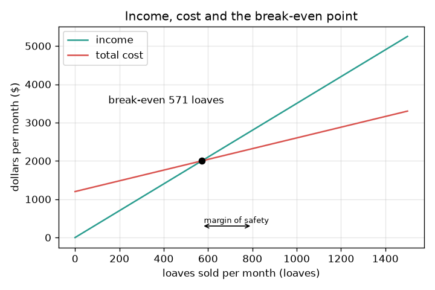
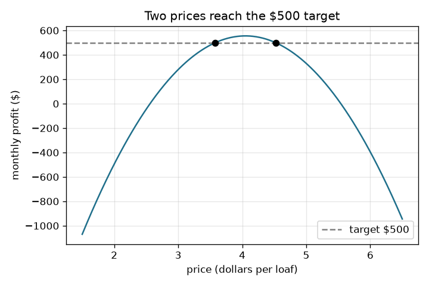

# Session 2: The break-even equations: contribution, safety and leverage

*Level 2 (mathematical engineering model) · about 75 minutes · openbreakeven*

> This is a simplified educational model. It is not a validated design tool and must not be used for real structures, electrical installations, vehicles, industrial processes or medical decisions.

**Prerequisites**

- Session 1: cost, income, profit and break-even.
- Solving a linear equation, and a quadratic with the formula (only in the design problem).

**Learning objectives.** After this session you can:

- Write profit = (p - v) q - F and explain the contribution margin.
- Compute break-even quantity and break-even revenue, and verify them by scanning q numerically.
- Find the margin of safety, the quantity for a target profit and the degree of operating leverage.
- Solve a design problem: choose a price that hits a target profit when demand falls as price rises.

## A. Real-world problem
A made-up neighbourhood bakery sells loaves. Each month it pays 1200 dollars for rent, an oven lease and wages, whether or not anyone buys bread. Each loaf sells for 3.50 dollars and costs 1.40 dollars in flour and energy. The owner expects to sell 800 loaves a month. How many loaves are needed to break even? How far can sales fall before the bakery loses money? How many loaves earn 600 dollars? And how risky is this business compared with another one? (General education only: the bakery and its numbers are made up and this is not financial advice.)

## B. Concept and theory
Profit = income - cost = p q - (F + v q) = (p - v) q - F. The contribution margin p - v is what each loaf contributes towards the fixed cost; its share of the price, (p - v) / p, is the contribution ratio. Setting profit to zero gives the break-even quantity q* = F / (p - v), and the break-even revenue is p q*, which equals F divided by the contribution ratio. The margin of safety, (q - q*) / q, is the share by which sales can fall before the profit disappears. For a target profit T, the quantity is (F + T) / (p - v). The degree of operating leverage, DOL = (p - v) q / profit, tells how strongly profit reacts to sales: a 10 percent change in sales changes profit by DOL times 10 percent. A business with big fixed costs has a high DOL: it gains a lot in good months and loses a lot in bad ones. For the design problem the quantity depends on the price through an estimated demand line, q = a - b p, so profit is a quadratic in p.

| Symbol | Meaning | Unit |
|---|---|---|
| p | price per loaf | dollars per loaf |
| v | variable cost per loaf | dollars per loaf |
| F | fixed cost per month | dollars per month |
| q | loaves sold per month | loaves per month |
| q* | break-even quantity | loaves per month |
| T | target profit | dollars per month |
| a, b | demand line: a = 1675 loaves, b = 250 loaves per dollar | loaves; loaves per dollar |
| DOL | degree of operating leverage | no unit |

**Assumptions**

- One product, one price, constant variable cost per loaf.
- Fixed cost stays fixed over the range of sales considered (Session 3 relaxes this).
- Everything produced is sold in the month.
- In the design problem demand is the straight line q = 1675 - 250 p (an estimate, not a measurement).
- The bakery and its numbers are made up.

$$ \text{profit}=(p-v)\,q-F $$

$$ q^{*}=\frac{F}{p-v},\qquad \text{break-even revenue}=p\,q^{*}=\frac{F}{1-v/p} $$

$$ \text{margin of safety}=\frac{q-q^{*}}{q},\qquad q_T=\frac{F+T}{p-v} $$

$$ \mathrm{DOL}=\frac{(p-v)\,q}{\text{profit}}=\frac{\%\text{ change in profit}}{\%\text{ change in sales}} $$

$$ (p-v)(a-b\,p)-F=T\;\Longrightarrow\; b\,p^{2}-(a+b\,v)\,p+(a\,v+F+T)=0 $$

## C. Visual explanation
The first figure shows income and cost lines against loaves. They cross at the break-even point of 571 loaves (571.43 exactly), where income is 2000 dollars, and the gap between the break-even and the expected 800 loaves is the margin of safety. The second figure plots monthly profit against price when demand falls as price rises: profit is a hill. The dashed 500 dollar target line cuts the hill at two prices, about 3.58 and 4.52 dollars, and the top of the hill is at 4.05 dollars.

*Income and cost against loaves: break-even at 571 loaves and the margin of safety up to 800.*

*Profit against price when demand falls as price rises: two prices reach the 500 dollar target.*

## D. Interactive simulation
Run the lesson (`python start.py 2`), then open the live app: [Session 2: the bakery equations](https://krunalpanchal1995.github.io/openbreakeven/session-02/) (or `app.html` in this folder). Move the sales slider and watch the bars, then open the lines and profit views. Compare the preset Plan with the preset Low fixed cost: same profit at 800 loaves, but see how the profit reacts when you cut sales to 500.

**Challenge.** At 800 loaves and a price of 3.50 dollars or less, earn at least 600 dollars profit a month.

## E. Worked example and experiment
**Problem.** For F = 1200 dollars, p = 3.50, v = 1.40 and 800 loaves a month, find the break-even quantity and revenue, the profit, the margin of safety, the loaves needed for a 600 dollar profit and the DOL. Then test the DOL with a 10 percent change in sales.

1. Contribution margin = 3.50 - 1.40 = 2.10 dollars per loaf; contribution ratio = 2.10 / 3.50 = 0.60.
2. Break-even quantity = 1200 / 2.10 = 571.43 loaves, so 572 whole loaves. Break-even revenue = 1200 / 0.60 = 2000 dollars.
3. Profit at 800 loaves = 2.10 * 800 - 1200 = 480 dollars.
4. Margin of safety = (800 - 571.43) / 800 = 0.2857, about 28.6 percent.
5. Loaves for 600 dollars: (1200 + 600) / 2.10 = 857.14, so 858 whole loaves.
6. DOL = 2.10 * 800 / 480 = 3.5. Test: sales up 10 percent (880 loaves) give profit 648 dollars, which is 35 percent more; sales down 10 percent (720 loaves) give 312 dollars, 35 percent less.
7. Scanning q on a fine grid and stopping when profit reaches zero also finds 571.43, so the formula is right.

**Answer.** Break-even 571.43 loaves (572 whole) or 2000 dollars; profit 480 dollars at 800 loaves; margin of safety 28.6 percent; 858 loaves for 600 dollars; DOL 3.5, so a 10 percent change in sales moves profit by 35 percent.

**Experiment.** Take a month of real or invented bakery records: count the fixed bills and the loaves sold, and estimate the cost of one loaf. Compute the break-even and compare it with the month where profit changed sign. Expect differences: costs such as energy are partly fixed and partly variable, wastage means not every loaf is sold, and discounts change the average price. The model has one clean price and one clean variable cost.

## F. Assessment and design challenge
**Question type A: Conceptual.** Two bakeries both earn 480 dollars at 800 loaves. Bakery X is the one in the worked example. Bakery Y has fixed cost 600 dollars and a variable cost of 2.15 dollars per loaf (more hired help, less rent), both at price 3.50. Which is riskier if sales fall by 10 percent, and why?

Hint

Compute the profit at 720 loaves for each and the percentage drop, or compare the DOL values.

Step-by-step solution

X drops from 480 to 312 dollars, a fall of 35 percent (DOL 3.5). Y has contribution margin 1.35 dollars and profit 1.35 * 720 - 600 = 372 dollars, a fall of 22.5 percent (DOL 2.25). X is riskier because more of its cost is fixed: its profit reacts more strongly to sales. X also gains more in a good month. Operating leverage is risk in both directions.

**Question type B: Numerical.** A cafe has F = 900 dollars, price 5 dollars and variable cost 2 dollars. Find the break-even quantity and revenue, and the quantity needed for a 600 dollar profit. Check the units.

Hint

Contribution margin first.

Step-by-step solution

Margin = 5 - 2 = 3 dollars per item. Break-even = 900 / 3 = 300 items and revenue = 300 * 5 = 1500 dollars. For 600 dollars: (900 + 600) / 3 = 500 items. Units: dollars per month divided by dollars per item gives items per month. Sanity check: at 500 items, profit = 3 * 500 - 900 = 600.

**Question type C: Graph and simulation interpretation.** On the profit-against-loaves line of the worked example, what are the value at 0 loaves, the slope, and the point where it crosses zero? What does each mean?

Hint

The line is (p - v) q - F.

Step-by-step solution

At 0 loaves the profit is minus 1200 dollars: the fixed cost you pay even if you sell nothing. The slope is 2.10 dollars per loaf, the contribution margin. The line crosses zero at 571.43 loaves, the break-even. To the right of it you are in profit.

**Question type D: Design and optimisation challenge.** Design: with demand q = 1675 - 250 p, variable cost 1.40 dollars and fixed cost 1200 dollars, choose a price that gives 500 dollars profit. How many prices work, what do they sell, and can the bakery reach 600 dollars?

Hint

Solve 250 p^2 - 2025 p + 4045 = 0, or scan prices on a grid and look for profit = 500.

Step-by-step solution

Two prices work: about 3.58 and 4.52 dollars. At 3.58 the bakery sells about 780 loaves, at 4.52 about 545. Both have margin of safety 500 / 1700 = 29.4 percent, but the cheaper price needs more flour, labour and oven time and has the larger break-even (551 loaves against 384). The most profit is at 4.05 dollars, about 555.6 dollars, so a target of 600 dollars cannot be reached at any price. Trade-off: the higher price gives the same profit with less work but depends on the demand estimate being right.

Score yourself with [RUBRIC.md](../../RUBRIC.md). Print the [activity sheet](activity_sheet.md) to work on paper.

## Common misconceptions
| Common misconception | What is actually true |
|---|---|
| A product with a big price always breaks even faster. | What matters is the contribution margin p - v, not p: a high price with a high variable cost may leave a small margin. |
| Margin of safety is a profit. | It is a share of sales: how far sales can fall before the profit is zero. |
| A high degree of operating leverage is bad. | It means profit reacts strongly to sales, upwards as well as downwards. It is a risk measure, not a defect. |
| Fixed costs never change. | They are fixed only within a range of sales; Session 3 shows a second oven making them jump. |

## Glossary
- **contribution margin**: price minus variable cost: what one unit adds towards fixed cost
- **break-even quantity**: the sales volume where profit is exactly zero
- **margin of safety**: the share by which sales can fall before the profit becomes zero
- **target profit**: the profit the owner wants, used to find the sales needed
- **operating leverage**: how strongly profit changes when sales change, because of fixed costs

## Finish
1. Do the three coding tasks in [exercises.md](exercises.md).
2. Run `python start.py 2` again after your changes. It ends with the checkpoint; when it prints `PASS`, you are done. (Checkpoint only: `python start.py check 2`.)

Next: [Session 3](../session-03/README.md)
