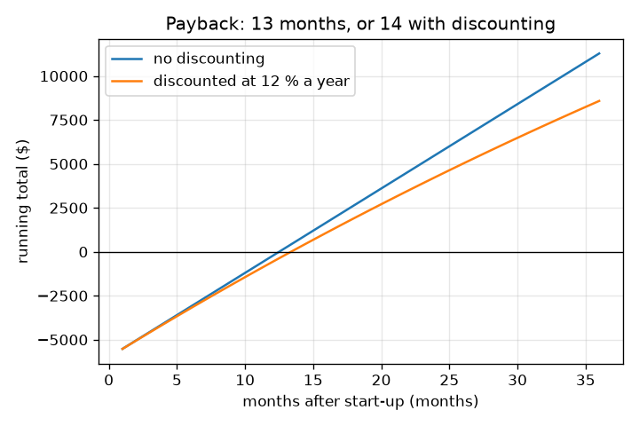
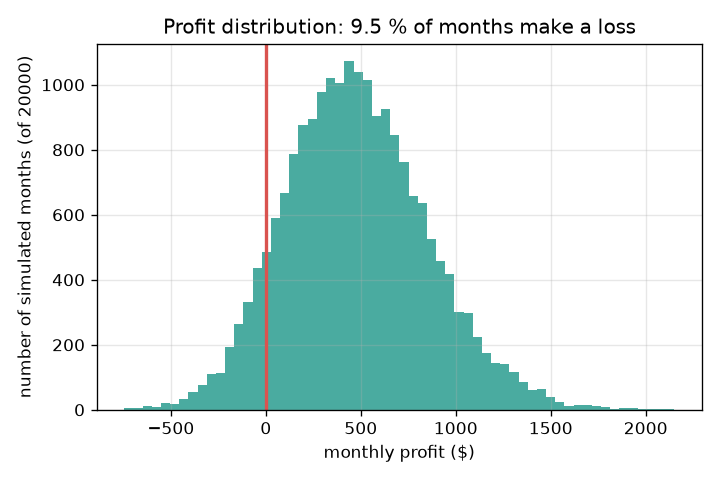
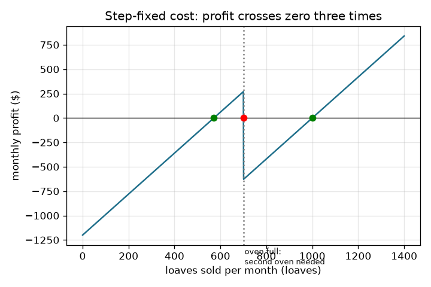
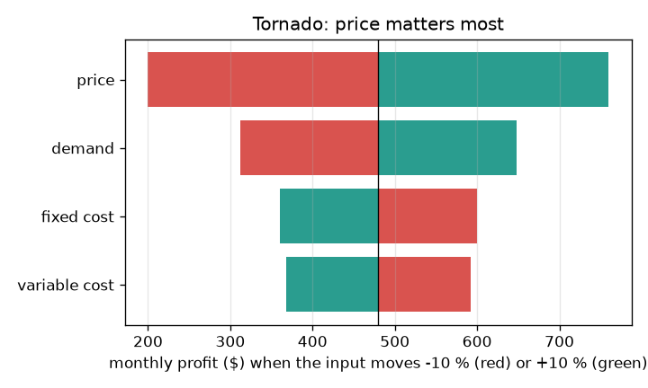

# Session 3: Break-even under mix, steps, uncertainty and time

*Level 3 (simulation and validation) · about 90 minutes · openbreakeven*

> This is a simplified educational model. It is not a validated design tool and must not be used for real structures, electrical installations, vehicles, industrial processes or medical decisions.

**Prerequisites**

- Session 1 and Session 2: break-even, contribution margin, margin of safety.
- Mean and standard deviation (explained in Section B).
- Optional: the openloan repo (monthly interest rates) and the opensupplydemand repo (demand curves).

**Learning objectives.** After this session you can:

- Find the break-even of a business with several products, and show how the sales mix moves it.
- Find every zero crossing of a profit curve with step-fixed costs by scanning numerically.
- Use a seeded Monte Carlo simulation to get the loss probability and profit distribution, and validate it against a formula.
- Rank inputs by their effect on profit, compute payback and net present value, and report when no break-even exists.

## A. Real-world problem
The made-up bakery of Session 2 is more complicated than one loaf at one price. It also sells cakes. When it grows it needs a second oven. Its price, its flour cost and its customers are never exactly what the plan says. And the start-up money is paid back slowly, month by month. A single break-even number hides all of that. Can we build a richer model, check it against a formula, and decide which input to watch and which price and oven size to choose? (General education only: made-up numbers, not financial advice.)

## B. Concept and theory
Several products: the sales mix gives each product's share of the units sold; the weighted contribution margin is the mix-weighted average of (p - v), and the break-even units of the whole business are F divided by it. A different mix gives a different break-even, even with the same fixed cost. Step-fixed costs: if one oven bakes at most 700 loaves a month and a second oven adds a fixed cost above that, the fixed cost jumps and so does the profit line, so profit can cross zero several times; we find the crossings by scanning whole loaves and compare them with F_k / (p - v) for each oven count k. Uncertainty: we draw 20000 random months with a fixed seed from normal distributions for price, variable cost and demand, compute the profit of each and count how many are negative. Reference: if only demand is random, the loss probability is the normal probability that demand is below q*. Sensitivity: change one input by minus and plus 10 percent and note the profit; the input with the widest swing matters most (a tornado chart). Time value: money received later is worth less. Discounting divides month t's cash by (1 + r)^t, with monthly rate r = (1 + annual rate)^(1/12) - 1. Payback is the first month the running total reaches the start-up cost; NPV is the discounted cash minus the start-up cost. Failure cases: if p <= v there is no break-even; if demand falls as price rises there are up to two break-even prices, or none if the fixed cost is too big.

| Symbol | Meaning | Unit |
|---|---|---|
| w | weighted contribution margin | dollars per unit |
| s_i | share of units for product i | no unit |
| k | number of ovens | no unit |
| cap | loaves one oven can bake (700) | loaves per month |
| sigma | standard deviation of a random input | same as the input |
| r | monthly discount rate | per month |
| NPV | net present value | dollars |
| C0 | start-up cost | dollars |

**Assumptions**

- Prices, variable costs and demand are independent and normally distributed (demand cannot go below zero).
- The standard deviations are made-up: price 0.20 dollars, variable cost 0.15 dollars, demand 150 loaves.
- Monthly profit is treated as cash received at the end of each month, with no tax and no loan.
- The sales mix is by number of units, not by revenue.
- The simulation uses a fixed seed so that every run gives the same numbers; another seed gives slightly different ones.
- All businesses and numbers are made up; this is a simplified educational model and not financial advice.

$$ w=\sum_i s_i\,(p_i-v_i),\qquad q^{*}_{\text{units}}=\frac{F}{w} $$

$$ F_k=F_1+(k-1)\,\Delta F,\qquad q_k=\frac{F_k}{p-v}\ \text{valid if}\ (k-1)\,\mathrm{cap}<q_k\le k\,\mathrm{cap} $$

$$ \text{profit}=(p-v)\,q-F,\quad p\sim N(\mu_p,\sigma_p^{2}),\ v\sim N(\mu_v,\sigma_v^{2}),\ q\sim N(\mu_q,\sigma_q^{2}) $$

$$ P(\text{loss})=\Phi\!\left(\frac{q^{*}-\mu_q}{\sigma_q}\right)\quad(\text{only demand random}) $$

$$ r=(1+i)^{1/12}-1,\qquad \mathrm{NPV}=-C_0+\sum_{t=1}^{n}\frac{c_t}{(1+r)^{t}} $$

$$ (p-v)(a-b\,p)=F\;\Longrightarrow\;b\,p^{2}-(a+b\,v)\,p+(a\,v+F)=0\ \ (\text{no real root: no break-even}) $$

## C. Visual explanation
Four figures. The step profit picture shows the profit line rising to a peak at 700 loaves, dropping when the second oven is needed, and rising again: it crosses zero three times, at 572 loaves upwards, at 701 downwards and at 1000 upwards. The histogram shows 20000 simulated months; the red part, about 9.5 percent of the months, is the loss. The tornado chart shows bars for price, demand, fixed cost and variable cost; price has the widest bar. The payback figure shows the running total rising through zero at month 13, or month 14 when discounted at 12 percent a year.

*Running cash total after a 6000 dollar start-up: payback at month 13, month 14 when discounted.*

*Monte Carlo profit distribution of 20000 simulated months; the red part is the loss.*

*Profit with a second oven: it crosses zero up at 572, down at 701 and up at 1000 loaves.*

*Tornado chart: price moves profit most, then demand, fixed cost and variable cost.*

## D. Interactive simulation
Run the lesson (`python start.py 3`), then open the live app: [Session 3: risk and sensitivity](https://krunalpanchal1995.github.io/openbreakeven/session-03/) (or `app.html` in this folder). Open the histogram view and raise the demand uncertainty slider; watch the red area (the loss chance) grow. Then open the tornado view and see which bar is longest. Change the fixed cost and the price and see how both views react.

**Challenge.** Reach a margin of safety of at least 40 percent at the planned demand (the readout shows it).

## E. Worked example and experiment
**Problem.** The bakery sells loaves (price 3.50, variable cost 1.40) and cakes (price 18, variable cost 9) in the unit mix 80 percent loaves and 20 percent cakes, with F = 1200 dollars. Find the break-even, then find the profit crossings if a second oven (900 dollars more) is needed above 700 loaves, and the chance of a loss when only demand is random (mean 800, standard deviation 150, loaves only).

1. Weighted margin = 0.8 * 2.10 + 0.2 * 9.00 = 1.68 + 1.80 = 3.48 dollars per unit.
2. Break-even units = 1200 / 3.48 = 344.8, which is about 275.9 loaves and 69.0 cakes. If the mix shifts to 90 percent loaves the weighted margin is 2.79 and the break-even rises to 430.1 units; at 60 percent loaves it is 246.9 units.
3. Step costs, loaves only: with one oven (fixed 1200) the break-even is 571.43 loaves; profit at 700 loaves is 270 dollars. At 701 loaves the fixed cost is 2100 and the profit is minus 627.90 dollars. With two ovens the break-even is 2100 / 2.10 = 1000 loaves. Scanning whole loaves finds the sign changes at 572 (up), 701 (down) and 1000 (up).
4. Loss chance with only demand random: q* = 571.43, so z = (571.43 - 800) / 150 = -1.524 and P(loss) = 0.0638, about 6.4 percent. The simulation of 20000 months gives about 6.5 percent.

**Answer.** Break-even 344.8 units for the 80/20 mix (275.9 loaves, 69.0 cakes); with the second oven the profit crosses zero up at 572, down at 701 and up again at 1000 loaves; the loss chance with only demand random is about 6.4 percent by formula and 6.5 percent by simulation.

**Experiment.** Keep a small record of daily sales for a school or club stall for a few weeks. Compute the mean and standard deviation of daily sales and use them in `simulate_profit`. Compare the predicted share of loss-making days with the real count. Expect the two to differ: real demand is not normal, it has weekday patterns and the weather matters, and the prices and costs may not be independent of demand.

## Real-world application and mini-project: Choose the price and the oven size for a made-up bakery
The owner may buy a 600, 800 or 1000 loaf oven (`OPTIONS` in the Session 3 lesson gives the monthly fixed cost and the start-up cost of each) and may set any price from 3.00 to 5.00 dollars in steps of 0.25. Demand is 1675 minus 250 times the price (loaves per month) and sales cannot exceed the oven's capacity. Use `evaluate` from Session 3 to report, for every choice, the break-even quantity, the margin of safety, the loss probability and the payback in months. A choice passes if the loss probability is at most 5 percent, the payback is at most 12 months and the margin of safety is at least 20 percent. Among the passing choices, recommend the one with the highest mean monthly profit. General education only: the numbers are made up.

**Deliverable:** A script that prints a table of all 27 choices (3 oven sizes times 9 prices), marks which pass, names the recommended choice, and saves a plot of mean profit against price with one line per oven size.

**Success looks like:** The recommended choice is the 600 loaf oven at a price of 4.25 dollars (break-even about 351 loaves, margin of safety about 36 percent, loss probability about 4 percent, payback 9 months); only 4.00 and 4.25 dollars with that oven pass, and the 1000 loaf oven does not pay back within 36 months at 4.00 dollars.

## F. Assessment and design challenge
**Question type A: Conceptual.** Why can the break-even of a two-product business go down even though the fixed cost and all prices stay the same?

Hint

Think of the weighted contribution margin and the sales mix.

Step-by-step solution

The break-even units are F divided by the weighted margin. If the mix shifts towards the product with the larger margin per unit (cakes, 9.00 dollars, against 2.10 for loaves), the weighted margin rises and the break-even falls: 430.1 units for 90 percent loaves, 344.8 for 80 percent and 246.9 for 60 percent. The fixed cost and prices did not change; only the mix did.

**Question type B: Numerical.** A 6000 dollar oven and fit-out earns 480 dollars of cash each month. Find the simple payback month, the discounted payback month at 12 percent a year, and the NPV over 24 months at that rate.

Hint

Monthly rate = 1.12^(1/12) - 1. Add up discounted cash month by month and compare with 6000.

Step-by-step solution

Simple payback: 6000 / 480 = 12.5 months, so the running total first reaches zero in month 13. The monthly rate is 0.9489 percent. Discounted payback is month 14. The 24 month NPV is 4259 dollars (5520 dollars with no discounting). Discounting lowers the value of later cash, so the discounted payback is later and the NPV smaller. Units: dollars and months.

**Question type C: Graph and simulation interpretation.** In the Monte Carlo histogram, which part of the picture is the loss probability, and what would happen to it if demand became more uncertain (a larger standard deviation) with the same mean?

Hint

Look at the area left of the zero line, and at how the width changes.

Step-by-step solution

The loss probability is the share of the area (about 9.5 percent of the 20000 months) to the left of zero, the red part. A larger demand standard deviation widens the histogram. The mean profit stays near 480 dollars (the simulated mean is 476) but more months fall below zero, so the loss probability rises.

**Question type D: Design and optimisation challenge.** Design: the owner may choose the 600, 800 or 1000 loaf oven and a price from 3.00 to 5.00 dollars in 0.25 steps. A choice passes if the loss probability is at most 5 percent, the payback at most 12 months and the margin of safety at least 20 percent. Use `evaluate` to recommend one choice and explain the trade-off.

Hint

Loop over capacity and price, print loss, payback and mean profit, and filter with `passes`.

Step-by-step solution

Only the 600 loaf oven at 4.00 and 4.25 dollars passes. The best of them for profit is 4.25 dollars: break-even about 351 loaves, average sales about 546, margin of safety about 36 percent, loss probability about 4 percent, mean profit about 556 dollars a month and payback 9 months. A price of 3.50 fails because the payback is 21 months, and the 1000 loaf oven does not pay back within 36 months at 4.00 dollars because demand is below its capacity most months, so its extra fixed cost is wasted. Trade-off: the biggest oven looks safest for growth but has the highest fixed cost; the small oven loses some sales when demand is high.

Score yourself with [RUBRIC.md](../../RUBRIC.md). Print the [activity sheet](activity_sheet.md) to work on paper.

## Common misconceptions
| Common misconception | What is actually true |
|---|---|
| The break-even point is one fixed number for the whole business. | It depends on the sales mix, and on the range of sales (step costs), so it can have several values. |
| If expected profit is positive, a loss cannot happen. | With random demand, price and cost, a positive average still comes with a loss probability: about 9.5 percent in our bakery. |
| Simulation proves the answer. | Simulation only gives numbers for the assumptions you fed it; we validated it against a formula for the case where the formula exists. |
| The most uncertain input is the one that matters most. | Sensitivity depends on size and effect: price has the widest swing here, although demand has the biggest percentage uncertainty. |
| Payback tells you whether a business is worth it. | Payback ignores what happens after it and (undiscounted) ignores time value; NPV and the risk matter too. |

## Glossary
- **sales mix**: the share of the units sold that each product has
- **step-fixed cost**: a fixed cost that jumps when capacity is exceeded, for example a second oven
- **Monte Carlo**: estimating a result by running a model on many random draws
- **tornado chart**: bars showing how much profit moves when each input changes by the same percentage
- **discounting**: dividing future money by a growth factor so it can be compared with money today
- **net present value (NPV)**: discounted cash received minus the start-up cost
- **payback period**: the time until the running total of cash reaches the start-up cost

## Finish
1. Do the three coding tasks in [exercises.md](exercises.md).
2. Run `python start.py 3` again after your changes. It ends with the checkpoint; when it prints `PASS`, you are done. (Checkpoint only: `python start.py check 3`.)

Next: the [roadmap](../../promo/roadmap.md). Session 4 is yours to build.
